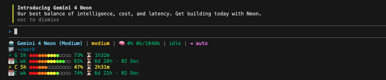

# agy-statusline

A custom status line for the [Antigravity CLI](https://antigravity.google/docs/cli/statusline) (`agy`), ported from a Claude Code statusline style: colored multi-line output with dot-bar quota gauges and reset countdowns.



## Features

- **Line 1** — active model, effort level, context-window usage (`%` + tokens used/limit, colored by threshold), agent state, and cycle mode (`accept-edits` / `auto` / `plan`) when non-default.
- **Line 2** — current working directory.
- **Quota rows** — both quota pools shown at once:
  - `⚡ G 5h` / `📅 G wk` — Gemini pool (5-hour & weekly)
  - `⚡ C 5h` / `📅 C wk` — 3P pool (Claude / GPT models, 5-hour & weekly)
- **Dot bars** — 14-segment gradient gauges; filled dots = consumed quota, colored red→green as remaining budget grows.
- **Reset countdowns** — `⏳ 2h59m` for hours, `6d 21h · 02 Dec` for multi-day resets.
- **Zero dependencies** — just `bash` and `python3` (stdlib only). Multi-line output and ANSI colors are supported natively by the Antigravity CLI.

The bucket pool matching the active model is sorted to the top.

## Install

```bash
curl -fsSL https://raw.githubusercontent.com/Rian23-R4/agy-statusline/main/install.sh | bash
```

Or manually:

```bash
git clone https://github.com/Rian23-R4/agy-statusline.git
cp agy-statusline/agy-statusline.sh ~/.local/bin/
chmod +x ~/.local/bin/agy-statusline.sh
```

Then add to `~/.gemini/antigravity-cli/settings.json`:

```json
{
  "statusLine": {
    "type": "command",
    "command": "/home/YOURUSER/.local/bin/agy-statusline.sh"
  }
}
```

`install.sh` does this automatically (with a backup of your settings file).

## Uninstall

```bash
bash install.sh --uninstall
```

## How it works

When the agent state changes, the Antigravity CLI pipes a JSON session payload to the script's stdin and renders its stdout in the TUI status line. Field schema: [official docs](https://antigravity.google/docs/cli/statusline).

Tested with `agy` **1.5.17**. If a CLI update changes the payload fields, please open an issue.

## License

MIT
